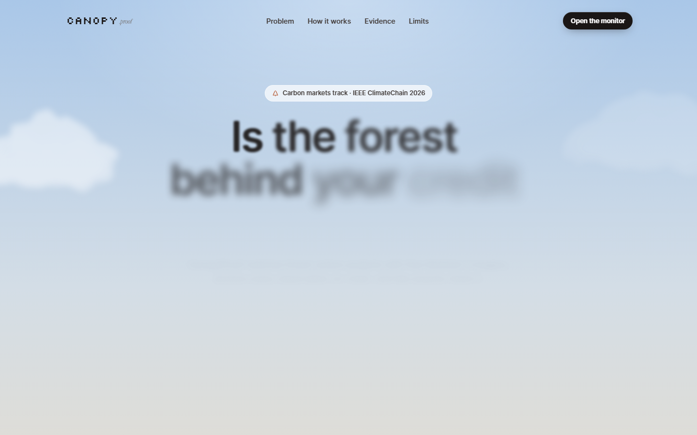
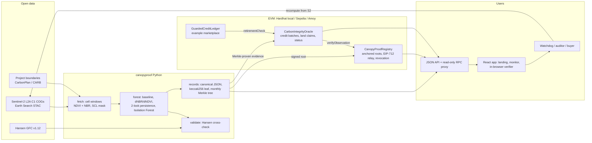

# CanopyProof

**Is the forest behind your credit still standing?** CanopyProof is open, satellite-verified
integrity monitoring for forest carbon credits. It reads free Sentinel-2 imagery for monitoring cells
inside carbon projects, detects burns and clearing pixel by pixel, turns every look into a signed,
content-hashed record, anchors monthly Merkle roots on-chain, and runs a smart contract that gives each
credit batch a public integrity status a marketplace can check before anyone trades or retires credits.
Anyone can verify any record against the chain, in the browser, and re-run the computation from the
original satellite pixels.

Built for the **IEEE ClimateChain Global Hackathon 2026**, track **Carbon Markets & Emissions
Transparency**. Prototype on a local chain, ready for Sepolia or Polygon Amoy. No mainnet, no real funds.

**Demo video:** https://youtu.be/9FBv9KQ4Ag8



## The problem

- West et al. (*Science* 381:873, 2023) studied 26 voluntary REDD+ projects in six countries. Most did
  not measurably reduce deforestation; of the 89 million credits 18 of them were expected to generate,
  the authors associate about 5.4 million (6.1%) with real emission reductions. Verra disputes the method.
- In January 2023 the Guardian, Die Zeit and SourceMaterial reported that more than 90% of Verra's
  rainforest offsets were likely "phantom credits"; Verra rejected the findings.
- Reversals after issuance are real too. In 2021 the Bootleg Fire burned through nearly 100,000 acres of
  the Klamath East project (ACR273) in Oregon. The project was terminated and at least 1.14 million
  credits had to be retired from California's buffer pool (CarbonPlan, 2023). In 2024 the owner sought to
  re-list 87% of the same land as four new projects.
- Ratings firms exist, but their evidence is closed. A buyer cannot independently check whether the
  forest behind a credit still stands.

CanopyProof addresses the part satellites *can* check, permanence: is the forest still there, and is the
evidence for that answer open, tamper-evident and reproducible? It does not judge additionality or
baselines.

## What it does

| Step | What happens | Where |
|---|---|---|
| Observe | Reads only the pixels of each 1 km monitoring cell from Sentinel-2 L2A Collection 1 Cloud-Optimized GeoTIFFs (Earth Search STAC, no API key). NDVI and the Normalized Burn Ratio on the 20 m grid, with a Scene-Classification mask. | `canopyproof/sentinel.py` |
| Detect | Seasonal per-pixel baseline from the project's baseline period. A pixel is disturbed when dNBR >= 0.27, or dNDVI >= 0.20 together with dNBR >= 0.15 (so wildfire smoke, which depresses NDVI but not NBR, is ignored). Loss is confirmed only after two clear looks at least 5 days apart. An Isolation Forest trained only on earlier years adds an advisory flag. | `canopyproof/forest.py` |
| Cross-check | Pixel-by-pixel comparison with the independent Hansen Global Forest Change v1.12 loss map. | `canopyproof/hansen.py` |
| Commit | Each look becomes canonical JSON (no floats, sorted keys). Its keccak256 plus the numbers a contract needs form a Merkle leaf. Leaves are signed (EIP-191) and one root per month is anchored, optionally relayed with an EIP-712 batch signature. | `canopyproof/records.py`, `canopyproof/chain.py` |
| Enforce | `CarbonIntegrityOracle` registers credit batches, refuses the same land cell for an overlapping vintage, accepts permissionless Merkle-proven evidence, derives Healthy / Watch / Reversal suspected from per-batch thresholds, keeps reversals sticky until an auditor resolves them with a public reason, and flags buffer-pool review. `GuardedCreditLedger` shows a marketplace freezing transfers and blocking retirement. | `contracts/contracts/` |
| Verify | CLI and an in-browser verifier rebuild the document hash and leaf, walk the Merkle proof, call `verifyObservation` on the contract, recover the signer, and can re-read the same Sentinel-2 pixels to reproduce the pixel digest. | `canopyproof/verify.py`, `web/src/lib/verify.ts` |

## Results from the demo data

Four real 1 km cells, every Sentinel-2 acquisition selected from January 2019 to 13 October 2026
(1,132 records in 82 monthly batches).

| Cell | Project | Clear looks compared | Confirmed loss | First "reversal suspected" | Hansen GFC (2019-2024) |
|---|---|---|---|---|---|
| KE-FIRE-01, Bootleg Fire scar | ACR273 Klamath East (real, Oregon) | 146 | 98.8 ha of 99.6 ha forest | 7 Aug 2021 (fire ignited 6 Jul 2021) | precision 99.6%, recall 99.9% (1,735 pixels) |
| KE-STAND-01, unburned stand | ACR273 Klamath East (real) | 148 | 1.3 ha (below the 2% watch line) | never | Hansen shows no loss |
| ACR189-01, coastal conifers | ACR189 (real, California) | 140 | 1.0 ha (below the watch line) | never | Hansen shows no loss |
| AMZ-FRONTIER-01, Novo Progresso | representative Amazon cell, **not a project** | 102 | 79.7 ha | 13 Aug 2024 | precision 66.9%, recall 92.4% |

On-chain (local Hardhat node): three credit batches registered; ACR273 and the Amazon batch move to
"reversal suspected" and flag buffer-pool review, ACR189 stays healthy; a re-listing of the fire cell for
vintages 2019-2022 is refused with `LandAlreadyClaimed(cell, 2019, 1)` while vintages 2024-2026 are
accepted; the guarded ledger blocks retirement with `IntegrityHold(4)` for the two flagged batches and
retires credits of the healthy one. Anchoring a monthly root costs about 230,000 gas.

What these numbers do and do not show: the fire cell is a clear-cut case; the intact cells show the
noise floor (about 1 ha of confirmed change per 100 ha over seven years); in the Amazon cell CanopyProof
confirms more than Hansen, consistent with fire-degraded forest and dense 2024 smoke that Hansen's annual
loss product may not count. Four cells are an illustration, not a validation study.

## Architecture



A record's leaf is `keccak256(bytes.concat(keccak256(abi.encode(Observation))))`, where `Observation`
carries the cell and project commitments, acquisition time, mean NDVI and NBR, valid fraction, disturbed,
persistent, burn-like and cumulative-loss fractions (basis points), the off-chain status, flags, and the
keccak256 of the full JSON document. Trees use sorted pairs, so OpenZeppelin `MerkleProof` verifies
them. Cells are identified on-chain by salted commitments, not coordinates.

## Smart contracts

| Contract | Key functions |
|---|---|
| `CanopyProofRegistry` | `anchorBatch`, `anchorBatchWithSignature` (EIP-712, relayer pays gas, nonce replay protection), `revokeBatch`, `verifyObservation`, `observationLeaf`; duplicate roots refused |
| `CarbonIntegrityOracle` | `registerCreditBatch` (land-cell x vintage-year double-claim check), `submitEvidence` (permissionless, Merkle-proven, newer-than-last only), `previewStatus`, `integrityStatus`, `retirementCheck`, `indicativeAffectedCredits`, `resolveSite` (auditor, public reason); events `ReversalSuspected`, `BufferPoolReviewFlagged` |
| `GuardedCreditLedger` | example: `mint` capped at issued credits, `transfer` frozen on suspected reversal, `retire` only when healthy and fresh |

Solidity 0.8.28, OpenZeppelin Contracts 5.6.1, Hardhat 2.29.

## Quick start (Windows PowerShell; bash works the same)

Requirements: Python 3.11+ (tested on 3.12), Node.js 20+ (tested on 22), Git.

```powershell
# 1. Python pipeline
python -m venv .venv
.venv\Scripts\python -m pip install -r requirements.txt

# 2. Contracts
cd contracts; npm install; npx hardhat compile; npx hardhat test; cd ..

# 3. Web app
cd web; npm install; npm run build; cd ..

# 4. Local chain (keep this terminal open)
cd contracts; npx hardhat node

# 5. In a second terminal: build records, deploy, anchor, run the integrity oracle
.venv\Scripts\python -m canopyproof demo

# 6. Open the app
.venv\Scripts\python -m canopyproof serve      # http://127.0.0.1:8080
```

The committed `data/` folder already holds the Sentinel-2 statistics and rasters, so steps 1-6 need no
satellite download. To refresh from the satellites: `python -m canopyproof fetch` (about 25 minutes for
four cells), then `validate`, `chips` and `demo`.

| Command | What it does |
|---|---|
| `fetch [--site ...]` | read Sentinel-2 cell windows from Earth Search (network) |
| `build` | change analytics, canonical records, monthly Merkle batches (offline) |
| `validate` | pixel comparison with Hansen GFC (network) |
| `deploy` | deploy the three contracts to the local Hardhat node |
| `anchor [--network] [--direct]` | sign records and batches, anchor roots (relayed by default locally) |
| `integrity [--network]` | register credit batches, run the double-claim check, submit watchdog evidence, try the guarded ledger |
| `verify <record_id> [--recompute] [--tamper loss=0.0000]` | full verification report |
| `records [--site] [--status]` | list record ids |
| `notes [--llm]` | plain-language notes (offline template; `--llm` uses Nebius AI Studio if a key is configured) |
| `serve` | JSON API (`/api/endpoints`), read-only RPC proxy and the web app |

Example:

```text
> python -m canopyproof verify KE-FIRE-01:S2A_T10TFN_20210807T185412_L2A --recompute
  [PASS] Document hash (keccak256 of canonical JSON)
  [PASS] Leaf rebuilt from the document
  [PASS] Merkle proof to batch 2021-08 root
  [PASS] Root anchored on-chain  - CanopyProofRegistry ... batch #30
  [PASS] On-chain manifest hash matches
  [PASS] Batch not revoked
  [PASS] Smart contract verifyObservation()
  [PASS] Record signature (EIP-191) recovers to the batch attestor
  [PASS] Recomputed from the original Sentinel-2 COGs  - NDVI mean 0.1316 vs 0.1316; pixel digest matches
VERIFIED
```

## Tests

```powershell
cd contracts; npx hardhat test                 # 20 tests: registry, oracle, ledger
.venv\Scripts\python -m pytest                 # 57 tests, incl. an end-to-end run on a throw-away Hardhat node
```

The Python suite covers canonical JSON, Merkle proofs, cell geometry and keys, Sentinel-2 masking and
index maths, the change rules (including that haze is not loss and that results are "as of" each
acquisition), records and batches, the JSON API and server, and a chain integration test in which the
Solidity verifier accepts every Python-built leaf and the oracle reaches the same verdict as the
analytics.

## Public testnet

Everything is prepared but not executed: a testnet needs a wallet and faucet funds that only the
project owner should create. See [KEYS_NEEDED.md](KEYS_NEEDED.md). `contracts/scripts/deploy.js`
refuses any chain other than Hardhat (31337), Sepolia (11155111) and Polygon Amoy (80002).

## Data sources and licences

| Data | Source | Licence |
|---|---|---|
| Sentinel-2 L2A Collection 1 | ESA Copernicus, via Earth Search STAC (Element 84) on AWS Open Data | Copernicus Sentinel data terms; "contains modified Copernicus Sentinel data 2019-2026" |
| Global Forest Change v1.12 | Hansen et al. (2013), University of Maryland / Google | CC BY 4.0 |
| California forest offset project boundaries | CarbonPlan, Zenodo record 8259842, from CARB, ACR and CAR | CC BY 4.0 |
| Web basemaps | Esri World Light Gray Canvas (with OpenStreetMap contributors) and Esri World Imagery | Esri terms, attributed on the map |

Monitoring-cell selection: two cells inside the ACR273 boundary (one in the 2021 burn, one with no
Hansen loss 2017-2024), one inside ACR189 (no Hansen loss 2015-2024), and one representative Amazon
frontier cell near Novo Progresso, Para, where Hansen records 2024 loss. Issued-credit numbers other than
ACR273's documented 1.14 million are illustrative and labelled as such.

## Limitations

- Satellite change detection is **evidence for review, not proof of carbon loss**. Harvest permitted by
  a project's rules, storms, insects, drought and phenology can look like change.
- It checks permanence only. It says nothing about additionality, baselines or leakage, which is where
  the studies above found most of the over-crediting.
- A 1 km cell samples a project; it does not measure the whole project or its carbon stock. The
  "indicative affected credits" figure scales issued credits by the mean loss across sampled cells and
  is only as good as the sample (two cells for ACR273 is far too few).
- Clouds, smoke and haze are masked imperfectly. The two-look rule and the dNBR requirement reduce false
  alarms; they do not remove them.
- The attestor key is a single point of trust for what gets anchored; the pipeline is open and
  deterministic so anyone can re-run it and compare, and the verifier can recompute any record from the
  original pixels. Withholding records is still possible and would need monthly completeness checks
  against the public STAC catalogue.
- Local chain and testnets only. No funds, no real credits.

## Roadmap

Systematic grids of cells per project; Sentinel-1 radar for cloudy tropics; a completeness proof per
month against the STAC catalogue; IPFS or Arweave for batch files; registry adapters (Verra, ACR, CAR)
for boundaries and issuance data; multiple independent attestors with threshold signatures.

## Repository layout

```text
canopyproof/   Python pipeline, CLI, JSON API and verifier
contracts/     Solidity contracts, Hardhat tests and deploy script
web/           React landing page and monitor (built from the shared design kit)
data/          sites, projects, Sentinel-2 statistics and rasters, records, batches, validation
docs/          screenshots
tests/         pytest suite
```

## Credits

Created by Yashvardhan Thanvi. Sentinel-2 data: ESA Copernicus. Earth Search: Element 84. Global Forest
Change: Hansen et al., UMD and Google. Offset boundaries: CarbonPlan. Libraries: OpenZeppelin, Hardhat,
web3.py, ethers.js, rasterio/GDAL, NumPy, scikit-learn, React, Motion, Tailwind CSS, Leaflet.
Code under the [MIT licence](LICENSE).
